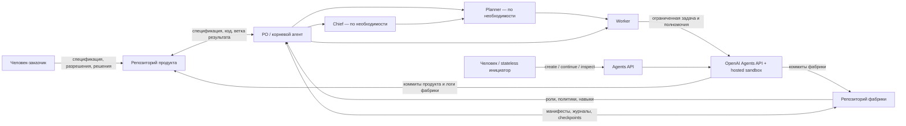
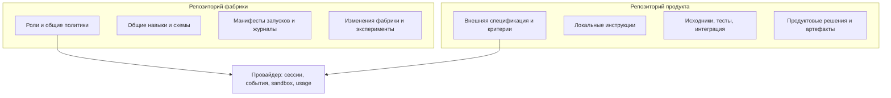

# Архитектура и решения

## 1. Архитектурные цели

Архитектура удовлетворяет одновременно требованиям продукта и развития фабрики. Каждый запуск обслуживает один целевой продукт, но использует общую версионируемую конфигурацию фабрики. Иерархия агентов определяется PO во время работы, а долговременные решения, задачи, логи, распределение ресурсов и ссылки на артефакты сохраняются в репозиториях GitHub.

Архитектура не предполагает атомарность Git между репозиториями, постоянное локальное рабочее место или собственный постоянно работающий сервер. Агентная сессия и sandbox — вычислительные ресурсы и контекст, а не единственный экземпляр состояния.

## 2. Компоненты и потоки

### Компоненты

1. **Два GitHub-репозитория.** Фабрика хранит общие инструкции, схемы, записи запусков и изменения фабрики. Репозиторий продукта хранит внешние требования, локальные инструкции, код и продуктовые артефакты. Конкретные run-данные и полномочия не копируются в публичный репозиторий фабрики, если там есть приватные продуктовые сведения.
2. **Agents API.** Предлагаемый управляемый слой сессий и запуска Codex harness. Он хранит сессии/ходы и предоставляет управление событиями, продолжением работы и мультиагентным делегированием. Это провайдерная зависимость первого выпуска, не абстрактная гарантия переносимости.
3. **OpenAI-hosted sandbox.** Изолированная файловая среда для чтения репозиториев, команд, тестов и изменений. Она принадлежит сессии и может исчезнуть. Не считать workspace checkpoint.
4. **PO и подчинённые роли.** Агентные роли задаются инструкциями и конфигурацией сессии. PO всегда присутствует; Chief и Planner создаются, только если выбранная структура оправдана.
5. **Инициатор/оператор.** Человек или короткоживущий hosted workflow создаёт сессию, передаёт run ID, отслеживает события, отвечает на требуемые действия и возобновляет запуск. Долгоживущий веб-сервис не входит в базовую конструкцию. Если инициатором служит GitHub Actions, он только использует API и не является авторитетным хранилищем журналов.
6. **GitHub credential broker.** Краткоживущий токен GitHub App с минимальным доступом к двум заданным репозиториям передаётся через поддерживаемый механизм секретов. Если vault не подходит выбранному способу Git, выдать отдельные ограниченные полномочия через безопасный адаптер; не помещать постоянный PAT в промпт, исходники или логи.

## 3. Контекст и владение

Внешняя спецификация и критерии приёмки принадлежат заказчику продукта. Общие инструкции и governance фабрики меняются только полномочной ролью. Продуктовые инструкции имеют приоритет в локальных технических вопросах, но не отменяют безопасности, согласия человека или бюджетных границ. Развёртывание и публикация приватных данных требуют отдельного согласия, а не следуют из факта принятия кода.

## 4. Рассмотренные варианты

| Вариант | Преимущества | Недостатки | Вывод |
|---|---|---|---|
| Agents API + OpenAI-hosted sandbox + GitHub | Управляемая сессия и среда; API делегирования; облачное выполнение; не требуется свой хост для агентов. | Вызов API и права GitHub всё равно требуют вызывающей стороны; контекст и workspace провайдера не заменяют Git; доступность функций/лимитов аккаунта необходимо проверить. | **Рекомендуется для v1.0** при прохождении прототипов и решения по данным. |
| ChatGPT/Codex интерфейс с вручную подключёнными репозиториями | Низкий порог для ручного запуска. | Нет доказанной из документации эквивалентности всем требованиям по межрепозиторному состоянию, программному учёту, квотам и восстановлению. | Возможный операторский интерфейс, но не считать реализацией системного контракта без проверок. |
| Agents SDK в собственном приложении | Максимальный контроль над обработкой состояния, handoff и подтверждениями. | Нужны размещённый runtime, persistence и жизненный цикл; риск введения постоянной оркестрации. | Не базовый путь v1.0; допустим адаптер, если он остаётся короткоживущим и управляемым. |
| Самостоятельный постоянный оркестратор/БД | Удобный центральный контроль. | Противоречит антицелям и добавляет обслуживание и единую точку отказа. | Отклонён. |

## 5. Решения (предварительные ADR)

### ADR-001 — GitHub как долговременный источник истины

Запуск получает `run_id`; все назначения, решения, сведения о квотах и состояния привязаны к нему и записываются в репозитории фабрики. Продуктовые результаты и критерии остаются в продуктовой репе. Ссылки/commit SHA связывают две независимые истории. Если запись в один репозиторий не удалась, run становится `reconciliation_required`, и никакая следующая задача не объявляется завершённой до согласования.

**Последствие:** повторное чтение Git и reconciliation обязательны; не использовать только историю чата или сессию провайдера.

### ADR-002 — PO выбирает иерархию по оценке сложности

PO всегда назначается. Сначала он оценивает размер, неопределённость, интеграционные связи, параллелизм, риски и бюджет. Прямые Worker-задачи — по умолчанию для связной небольшой работы; Planner — если есть автономная область декомпозиции; Chief — если есть несколько направлений с общими ресурсами или зависимостями. Число ролей и критерии создания фиксируются в журнале решения.

**Последствие:** одна роль может выполнять несколько задач последовательно, но не следует представлять единственного PO как отдельный Chief/Planner.

### ADR-003 — Требования сохраняются как неизменяемый baseline

PO создаёт структурированный реестр требований, цитирующий исходную спецификацию и её commit SHA. Уточнение требований может добавлять заметки/связи, но не менять исходный критерий. Изменение внешнего требования проходит отдельную авторизацию заказчика, версионируется и не переписывает прошлую приёмку.

### ADR-004 — Две фазы записи результата

Агент пишет в отдельную рабочую ветку каждого репозитория, а не в защищённую основную ветку. Сначала он фиксирует коммиты и состояние каждой репозитории отдельно. Результат продукта проходит локальную проверку менеджера и интеграционную приёмку PO; фабричный журнал проходит проверку на фактичность и секреты. PR/слияние в каждом репозитории независимы. Манифест связи хранит оба состояния (`pending`, `committed`, `accepted`, `merged`, `conflict`).

### ADR-005 — Возобновление опирается на checkpoint, не на живую память

При завершении окна, предупреждении о квоте, перед передачей человека и после значимой стадии записываются обновлённые манифест, состояние задач, назначения, коммиты, pending actions и next steps. Следующая сессия загружает репозитории и проверяет актуальные ветки до возобновления. Если прежняя среда и сессия доступны, можно продолжить их; если нет — создать новую с явной связью `resumed_from`.

**Граница:** подтверждённая сессионная персистентность не означает автоматического запуска по сбросу квоты, гарантированной сохранности файлов среды или неограниченного времени жизни сессии.

### ADR-006 — Контроль расходов через ledger, с unknown как полноценным значением

Лимит запуска и его распределение задаются человеком или PO в разрешённых диапазонах. Руководитель резервирует ресурсы дочерним задачам до старта, закрывает резерв по завершении и пересчитывает остаток. Измерения API — best-effort данные, а не счёт; отсутствующее usage записывается `unknown`. Лимит API/тарифа и платёжное ограничение учитываются отдельно; никакое увеличение бюджета автоматически не выполняется.

### ADR-007 — Изменение фабрики утверждает вышестоящий руководитель

Агент не изменяет собственную базовую инструкцию. Предложение содержит evidence, область действия, ожидаемый эффект и обратный план. Утверждение записывается отдельным решением; изменённая версия тестируется на новых сопоставимых задачах и может быть возвращена.

## 6. Требует одобрения человека

Следующие решения нельзя принять из предположения:

- Платформа и способ оплаты для демонстрационных и эксплуатационных запусков.
- Допустимость обработки продуктовых данных и сроки их хранения в выбранном облачном контуре.
- Можно ли инициировать запуски и продолжения через GitHub Actions; если нет — какой уже существующий hosted trigger использовать.
- Окончательная политика слияния (в текущем проекте рекомендованы отдельные PR и human review для production-веток).
- Максимальный денежный бюджет запуска, пороговые лимиты и право PO перераспределять их. До явного лимита PO не может инициировать дополнительные платные ресурсы.
- Условия, при которых человек принимает интегрированный продукт; агентная проверка не подменяет назначенного заказчика.

## 7. Архитектурные ограничения первого релиза

В v1.0 поддерживается один основной провайдерный адаптер — Agents API. Внутренние контракты среды и идентификаторов отделяются от провайдерных полей, но второй адаптер не требуется. Не вводятся обязательные базы данных, постоянная очередь, сервер, автозапуск после сброса квоты, собственная аналитика или автодеплой. Система может использовать опубликованные файлы и события API для наблюдения, но критические решения и состояние запуска сохраняются в Git.
