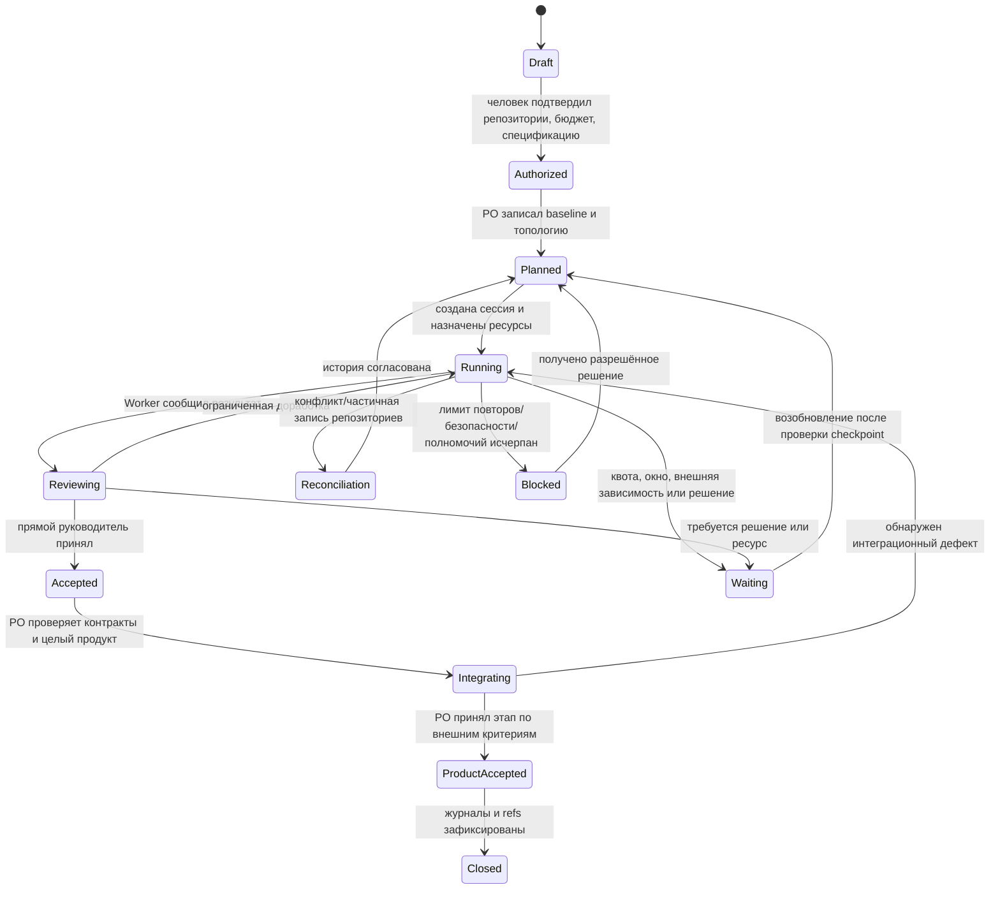

# Производственный процесс

## 1. Полномочия и контекст ролей

| Роль | Область ответственности | Может делегировать | Может принимать | Может менять базовые инструкции |
|---|---|---|---|---|
| Человек-заказчик | Авторизация продукта, разрешения, бюджет, неизменяемые правила фабрики | PO и системные разрешения | Изменения требований и конечную приёмку по своей роли | Любые, включая базовую инструкцию PO |
| PO | Весь продукт, требования, топология, зависимости, интеграционная приёмка, общий бюджет если нет Chief | Chief, Planner, Worker | Этапы направления/продукта после доказательств | Chief и непосредственно подчинённых; не собственную |
| Chief | Общие производственные ресурсы и координация нескольких направлений | Planner | Результаты Planner, системные эскалации | Подчинённых Planner; не собственную |
| Planner | Явно назначенное направление/эпик | Worker и подзадачи | Работу Worker и дочерних задач | Назначенных Worker; не собственную |
| Worker | Назначенная конкретная задача | Не делегирует (если явно не разрешено отдельным контрактом) | Технические проверки как данные, но не собственную работу | Никакие базовые инструкции; не меняет общие правила |

Менеджер может менять задачно-специфичные инструкции подчинённому в пределах назначения. Это не меняет его базовую роль. Любой работник может остановиться и сообщить блокировку, но не имеет права расширять права или бюджет.

## 2. Сквозной жизненный цикл

`Closed` не означает развёртывание. Развёртывание, приобретение услуг и публикация требуют отдельного разрешения. Переход к `Waiting` — штатная остановка, не ошибка. `Blocked` означает, что до изменения внешнего состояния/получения решения безопасной работы нет.

## 3. Декомпозиция и контракт назначения

1. PO читает спецификацию по фиксированному commit SHA, формирует реестр требований и карту зависимостей.
2. PO фиксирует оценку сложности, рисков, диапазон ресурсов и топологию. Для простого задания выбирается PO→Worker. Для автономной области — PO→Planner→Worker. Для нескольких связанных направлений с общими ресурсами — PO→Chief→Planners→Workers. Допускается PO→несколько Planners.
3. Руководитель декомпозирует только свой scope. Каждый дочерний контракт сохраняет ссылки на родительские требования, критерии приёмки и зависимости. Запрещено закрывать родительскую задачу, пока её требования не покрыты принятыми дочерними результатами.
4. Назначение фиксирует цель, входные файлы/границы чтения, пути записи, зависимости, ожидаемый diff/артефакт, точные проверки, ресурсный резерв, таймауты, максимальное число попыток и условия остановки.
5. Роль получает только контекст, необходимый для работы. Worker не обязан знать мотивацию и состояние остальных направлений.

## 4. Приёмка результатов

### Worker → прямой руководитель

Worker пишет артефакт в ветку целевого продукта и фактический журнал в ветку фабрики. В отчёт входят commit SHA каждого репозитория, команды проверок и их статусы, файлы результата, ошибки/повторные попытки, доступные usage metrics и неизвестные значения. Worker не оценивает качество собственной роли или промпта.

Прямой руководитель сопоставляет результат с назначением и проверками. Он может принять, вернуть на одну ограниченную доработку или эскалировать. При каждом возврате задаётся конкретный дефект, необходимый минимальный diff и следующий предел ресурсов. После двух неудачных циклов по одному критерию руководитель обязан пересмотреть постановку и прекратить одинаковые повторы; более высокий лимит требует отдельного обоснования и доступного бюджета.

### Направление → PO

Planner передаёт PO принятые коммиты, покрытые требования, известные ограничения и интеграционные предположения. PO координирует контракты между направлениями и проверяет, что они совместимы с внешней спецификацией. Planner не может изменить общий контракт, скрыв его от PO.

### Интегрированный продукт → PO/заказчик

PO проверяет интеграционные и продуктовые критерии на целевом продукте. Локальные тесты доказывают только часть корректности. PO фиксирует `accepted`, `rejected` или `waiting_for_commissioner`, обосновывает решение ссылками на требования и свидетельства. Если критерий требует решения человека, он не считается принятым автоматически.

## 5. Изменение инструкций и обучение фабрики

1. Worker фиксирует факты без самоанализа.
2. Менеджер связывает факты с результатами, отличает единичную ошибку от повторяющегося паттерна, определяет область (продукт или фабрика) и оценивает альтернативные причины.
3. Если проблема в базовой инструкции самого менеджера, он создаёт предложение с evidence и направляет непосредственному начальнику. Сам менять эту инструкцию он не может.
4. Полномочный superior принимает, заменяет или отклоняет предложение; решение и diff версионируются с автором, старыми/новыми версиями, основанием, ожидаемой метрикой и датой/задачами применения.
5. Изменение не считается доказанным улучшением. План оценки задаёт сопоставимые задачи/контроль, метрики качества и ресурсов, срок наблюдения и условие отката.
6. Изменения для конкретного продукта пишутся в его репозиторий. Общее улучшение — в репозиторий фабрики. Публикация продуктового опыта в общий репозиторий проходит проверку на секреты и специфические предположения.

## 6. Ресурсная политика

Существует единый ledger на run с лимитами по провайдеру, продукту, модели и времени. Единицы записываются раздельно: токены, запросы/вызовы, время sandbox и денежная оценка. Неизмеренные расходы не превращаются в нули.

Перед назначением менеджер резервирует ожидаемый максимум. Параллельные задачи не могут резервировать сверх доступной суммы. Перерасход одной задачи уменьшает общий доступный остаток только если он фактически измерен или его верхняя граница предусмотрена политикой; неизвестная величина блокирует новое расходование до оценки/разрешения. Прогноз корректируется по завершённым задачам, но новый лимит согласуется уполномоченным человеком.

Рекомендуемый для старта стоп-правил v1.0: максимум две исполнительские попытки на один и тот же критерий и максимум один управленческий пересмотр назначения до эскалации. Это начальные значения для пилота, не обещание достаточности; уточнить после измерений и не поднимать автоматически. При получении 429 временного ограничения можно повторять только после соблюдения указанных провайдером пауз и в пределах лимита. Ошибки оплаты/квоты, требующие действий владельца, не ретраятся вслепую.

## 7. Остановка и восстановление

При исчерпании бюджета, конце окна или недоступности внешней зависимости менеджер:

1. запрещает создавать новые платные дочерние задачи;
2. фиксирует фактический статус текущих сессий/ходов и незавершённые действия;
3. записывает в обе репозитории актуальные коммиты и состояние согласования;
4. ставит задачи в `waiting` с `resume_condition`, ответственным и владельцем следующего решения;
5. прекращает или оставляет живые сессии согласно API и состоянию операций; отсутствие события не трактуется как завершение;
6. при возобновлении сверяет ветки/commits, активность сессии, checkpoint и provider usage, восстанавливает нерешённые действия и продолжает только отсутствующую работу.

Если сессия исчезла, новый PO перечитывает run manifest и оба репозитория, проверяет коммиты и критерии, затем создаёт новую сессию со ссылкой `resumed_from`. Ранее выполненная задача не повторяется, пока её commit и приёмка подтверждены.

## 8. Конфликты между репозиториями

Две записи никогда не считаются атомарными. Для логической единицы изменений применяется идентификатор события (например, `run_id/task_id/event_id`) и журналируются попытки записи каждого репозитория.

| Наблюдаемое состояние | Действие |
|---|---|
| Продуктовый commit есть, factory log отсутствует | Запретить принять задачу; повторить идемпотентную запись фактического журнала, затем связать SHA. |
| Factory log есть, продуктовый commit отсутствует | Сохранить журнал как попытку/черновик; проверить статус ветки и не заявлять о deliverable. |
| Оба commit есть, один конфликтует с актуальной базой | Остановить merge; создать reconciliation запись, обновить базу, повторно проверить diff и критерии с руководителем. |
| Сессия потеряла ответ после успешного push | Считать событие неизвестным; прочитать ветку и найти `event_id`/commit до повторного push. |
| Невозможно связать коммиты из-за параллельной работы | Не переписывать историю; создать корректирующую запись со ссылками на обе версии и явным решением. |

## 9. Эскалации

Эскалация идёт только непосредственному руководителю, кроме прямого запроса решения человека по его полномочиям. Она включает: `run_id/task_id`, наблюдаемые факты/ссылки, сделанные попытки, ожидаемый и фактический расход, риск, варианты в пределах полномочий и однозначный вопрос/запрошенное решение. Невыполнение срока само по себе не даёт права расширить бюджет или ослабить критерии.
