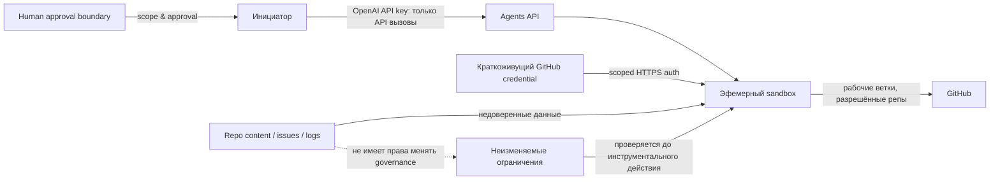

# Безопасность и модель полномочий

## 1. Активы и угрозы

### Активы

- Исходный код и история продукта, включая потенциально непубличные спецификации.
- Токены GitHub/OpenAI, содержимое vault и прочие учётные данные.
- Бюджет пользователя, тарифные лимиты и право запускать дополнительные расходы.
- Неизменяемые требования, критерии приёмки и базовые инструкции ролей.
- Журналы и ссылки, способные раскрыть коммерческие, персональные или внутренние данные.
- Целостность двух репозиториев и происхождение принятых артефактов.

### Модель нарушителя

Система учитывает ошибочный или скомпрометированный агент; вредоносный PR, issue, файл или зависимость; prompt injection в документации и выводе инструментов; подмену ветки между чтением и записью; кражу слишком широкого токена; случайную публикацию приватных данных; параллельные сессии, которые перезаписывают решения; и попытки скрыть недостаток результата изменением критерия. Внешний провайдер и GitHub рассматриваются как доверенные инфраструктурные стороны в пределах их опубликованных гарантий, не как источник безошибочной приёмки.

## 2. Базовые меры

1. **Минимальные права.** Отдельный временный GitHub App installation token для каждого продукта/запуска с доступом только к нужным репозиториям. Read-доступ по умолчанию; write только в рабочие ветки/разрешённые пути. Не давать агенту права менять branch protection, Actions secrets, collaborators, settings, releases или deployment environments.
2. **Секреты отдельно от промптов.** Ключ приложения Agents API принадлежит инициатору и никогда не передаётся в sandbox. Токен GitHub краткоживущий, ограниченный репозиториями и не включается в текст, конфигурационные файлы, командный вывод или commits. Предпочитать secret vault с ограничением целевых host; для команд, которым необходим прямой Git-клиент, отдельно проверить, что механизм не раскрывает токен в URL, args или traces.
3. **Недоверенный контент — это данные.** Текст из репозиториев, issues, комментариев, веб-страниц и логов не расширяет системные полномочия. Агент может учитывать локальные инструкции только после разрешения источника и сравнения их приоритета с неизменяемой политикой.
4. **Разделение веток.** Рабочий результат идёт в ветку запуска. Защищённая основная ветка не доступна для прямого push. Слияние — отдельное решение с независимыми проверками в каждом репозитории.
5. **Проверка основания перед действием.** Перед каждым write подтверждаются репозиторий, ref, требуемые пути, scope assignment, актуальная база и разрешение. Перед изменением базового промпта подтверждаются роль автора и superior-approval запись.
6. **Редакция логов.** Перед commit журнал проходит сканирование секретов и удаление персональных/коммерческих данных, не необходимых для аудита. Хранить фактическую краткую сводку и ссылки, не полные трассы по умолчанию.
7. **Нет скрытых внешних действий.** Deployment, покупка сервиса, публикация приватного репозитория, изменение защиты и разрушительные команды требуют явного разрешения человека с описанием конкретного действия.

## 3. Границы доступа и доверия

Человек утверждает глобальные бюджеты и изменение базовых инструкций PO. PO решает структуру и задачи в заданном бюджете, но не может ослабить критерии продукта. Менеджер принимает подчинённую работу в рамках назначения; Worker не принимает собственное изменение роли и не расширяет задачу.

## 4. Приоритет инструкций

Приоритет при сборке эффективного контекста:

1. Непереопределяемые платформенные и человеческие ограничения: безопасность, credential handling, права, бюджетный предел, запрет на внешнее действие без одобрения.
2. Общие governance-инструкции фабрики и полномочия конкретной роли.
3. Подтверждённая спецификация и критерии продукта (они задают требуемый результат, не роль/политику).
4. Локальные продуктовые инструкции в пределах архитектуры и стека.
5. Назначение задачи и дополнительные task prompt.
6. Содержимое репозитория/issue/вывода инструмента как данные; само по себе не источник полномочий.

При конфликте агент не выбирает более удобное указание. Он записывает ссылку на обе инструкции, заблокированное действие и передаёт вопрос на роль, имеющую полномочия. Если конфликт касается внешнего требования или неизменяемой политики, требуется человек.

## 5. Обработка данных и приватность

Публичные фабричные журналы должны содержать только обезличенные ссылки, минимальные факты и данные, разрешённые к публикации. Для приватного продукта применять отдельное приватное хранилище run records или приватный форк factory repo; не создавать публичное зеркало. Секретные исходники не помещать в issue titles, имя ветки, метаданные сессии, telemetry labels или имя артефакта.

До обработки реальных продуктовых данных заказчик определяет класс данных, допустимость выбранного провайдера, срок хранения, удаление сессий/артефактов и нужную резидентность. Текущие официальные документы Agents API сообщают об ограниченной географии хранения и отсутствии Zero Data Retention для этого API; выбор self-hosted sandbox сам по себе этих свойств не меняет. Следовательно, private/regulated данные нельзя считать допустимыми без отдельного решения владельца и проверки действующих условий.

## 6. Восстановление после инцидента

При подозрении на утечку агент прекращает сетевые и записывающие действия, сообщает идентификатор сессии/задачи и фиксирует только безопасное резюме. Уполномоченный человек отзывает/вращает токен и ограничивает установку GitHub App; менеджер проверяет commit history, API traces и изменённые refs. Потенциальные вредоносные изменения откатываются новым commit после оценки, не через переписывание истории. Запуск остаётся `blocked` до подтверждения новых credentials и сверки обеих репозиториев.

## 7. Проверки перед v1.0

- Доказать отсутствие API key инициатора в окружении агента и его логах.
- Проверить срок жизни, scope и реальную доступность GitHub App token только для целевых репозиториев и веток.
- Проверить prompt injection из issue и файла: он не должен менять роль, budget, allowlist или критерии.
- Проверить секретное сканирование, редактирование логов и историю корректировок.
- Проверить отрицательные сценарии: прямой push в protected branch, изменение требований, попытка изменить свой prompt, публикация приватного продукта, превышение лимита, удаление/перезапись истории.
