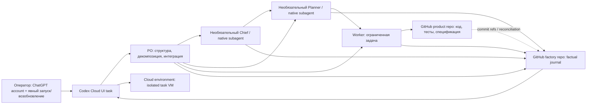
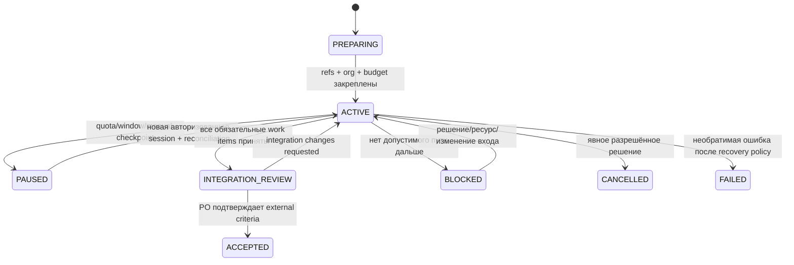

# AI Factory — системный дизайн 1.0 (Codex Cloud)

**Статус:** актуальная проектная редакция; Codex Cloud через ChatGPT-подписку (заменяет прежний API-based runtime выбор)
**Дата:** 18.10.2026
**Основание:** [`docs/specification.md`](../../specification.md)
**Объём этой работы:** проектирование и документация; реализация не выполнялась.

## 1. Цель и границы

AI Factory — повторно используемая облачная система, которая производит продукты в отдельных репозиториях GitHub, сохраняет производственную историю в репозитории фабрики и развивает общие практики только через проверяемые, разрешённые изменения. Версия 1.0 включает плоскую и многоуровневую организацию, общий учёт использования подписки, восстановление, две ступени приёмки и контролируемое улучшение инструкций.

**Выбранный runtime:** Codex Cloud из ChatGPT web/desktop под учётной записью с подходящим ChatGPT-планом. Производственные задачи используют только включённую квоту подписки; при исчерпании работа ставится на паузу до plan reset. Покупка кредитов, auto-reload, гибкая доплата и API-биллинг не входят в этот вариант. В продукте фабрики нет Agents API, Responses API, OpenAI API key, API app-server или внешнего backend-оркестратора. Это UI-управляемый вариант: человек запускает и возобновляет корневую Cloud task, а нативные субагенты Codex внутри неё выполняют делегированные роли. Ручная передача заданий между отдельными Cloud tasks не является рабочим процессом фабрики. Если проверка выявит ограничение Cloud, при котором продуктовая оргструктура не помещается в доступную иерархию/параллелизм, это блокер или предмет отдельного решения о scope, а не повод вводить ручной relay.

GitHub — долговременный источник прикладного состояния; опубликованная Cloud environment — повторно используемый образ tool/dependency setup, а workspace отдельной задачи — временное рабочее место. Нет собственного постоянно работающего сервера или отдельной производственной базы данных. Если Cloud UI/environments не позволяют доказать multi-role delegation, доступ к двум repos, recovery или приемлемые budget controls, это блокер 1.0/пункт для решения человека; запрещено незаметно переключаться на OpenAI API.

## 2. Архитектура



### 2.1 Владение

| Область | Авторитетное содержимое | Запись |
|---|---|---|
| Репозиторий фабрики (разрешительная лицензия, целевая Apache-2.0) | Роли, общие инструкции/навыки, схемы, active/archive runs, решения, бюджеты, журналы, эксперименты, история изменений фабрики | Только разрешённые роли через подключённую GitHub identity; operator scopes selected repos; branch protection/PR на базовых ветках |
| Репозиторий отдельного продукта | Внешняя спецификация, критерии и ограничения, allowlisted локальные инструкции, исходный код, тесты, интеграционные материалы и product history | Worker — только назначенные пути; руководитель — делегированные пути; PO — интеграция и приёмка |
| Codex Cloud environment/task | Публикуемый setup; VM и файлы конкретной Cloud task; task turns | Не является долговременным источником истины; после VM retention run восстанавливается из Git |

Один и тот же набор конфигурации фабрики подключается к многим продуктам, но состояния, ID и приватные данные разделены. Для публичного factory repo worker сохраняет обязательный factual journal в безопасном редактированном виде; чувствительное подробное свидетельство остаётся в закрытом product repo, а journal содержит классификацию редактирования, факт операции, result/status и ссылку/commit SHA без раскрытия секрета. Если сам факт или метаданные ссылки чувствительны, соответствующий deployment использует приватный factory repo; общие исходники фабрики могут оставаться публичными отдельно от приватного run data.

### 2.2 Компоненты

1. **Launch/authorization:** закрепляет project/run ID, точные repository refs, разрешённые права, требования и исходный лимит. Человек утверждает внешнюю спецификацию, верхнеуровневые ограничения, покупки, deploy, destructive действия, публикацию закрытых данных и governance changes.
2. **PO:** читает спецификацию полностью, выбирает минимально достаточную структуру, задаёт продуктовые контракты, интегрирует независимые направления и принимает только интегрированный результат против исходных критериев.
3. **Chief (условно):** вводится, когда несколько направлений делят общий бюджет, риск или production policy; распределяет учётную квоту и меняет инструкции только прямых подчинённых Planner.
4. **Planner (условно):** ведёт ограниченный эпик/направление, рекурсивно декомпозирует его и назначает Worker через нативных субагентов Codex, проверяет локальную приёмку и эскалирует за пределами authority/context/budget.
5. **Worker (обязателен):** реализует назначенную задачу, проводит перечисленные проверки, пишет разрешённые product paths и factual journal. Не проводит meta-analysis, не улучшает фабрику и не утверждает собственную role-base instruction.
6. **Run registry and journals:** machine-readable файлы в factory repo; append-only события/новые версии и явная коррекция с provenance. Нет скрытого перезаписывания истории.
7. **Codex Cloud environment profile:** публикуемый Cloud environment выбирает repos, setup, network access, допустимые environment variables/network secrets и зависимости. Ролевые инструкции и навыки остаются версионированными файлами репозитория. Модель/reasoning субагента наследуется от родителя, если для роли не задано явное поддерживаемое Cloud значение; роли задают preferred model/effort для своих assignments, а фактически наблюдаемая модель сохраняется или помечается `unknown`. Начальная целевая настройка — не более 6 одновременно открытых child threads на root session, если WP0 подтверждает этот предел в Cloud. Это настраиваемый предел планировщика, а не отдельная квота подписки; модель выбирается только из доступных в Cloud, без программного runtime adapter.

### 2.3 Рабочий цикл Codex Cloud по подписке

1. Оператор подключает GitHub account и выбирает factory repo и один product repo в Cloud environment, задаёт setup/network policy, проверяет и публикует environment. Доступность двух repos одновременно подтверждается отдельным WP0 gate.
2. Оператор из ChatGPT web/desktop выбирает `Work in > Cloud`, опубликованную environment и запускает task с run ID. Codex Cloud работает в своей VM; компьютер оператора может быть выключен.
3. PO внутри task читает закреплённые версии требований и фабрики, записывает орг-решение, work items и бюджеты в factory repo, затем делегирует независимые ветви native subagents. Chief и Planner могут создавать дочерних агентов в пределах глубины и параллелизма, подтверждённых в WP0. Parent ждёт отчёты, принимает локальные результаты и сводит их на своём уровне. Глубина ветви соответствует продуктовой роли; отдельные Cloud tasks не используются для передачи child assignments.
4. Worker изменяет назначенный product scope, проводит проверки, создаёт commit/PR и добавляет factual journal в factory repo. Роль агента задаётся assignment contract и инструкциями; Codex subagents наследуют разрешения корневого сеанса, поэтому путь/контекстные ограничения являются правилами делегирования и требуют проверки поведения, а не отдельной гарантией sandbox на каждого агента. PO принимает интеграцию; human product approval остаётся явной границей.
5. Для продолжения той же работы оператор открывает ту же Cloud task. Перед pause/завершением текущего сеанса корневой агент сохраняет assignments, статусы child threads и checkpoint в Git, чтобы продолжить работу после потери временного состояния VM.
6. Состояние задачи Codex Cloud удобно для недавнего продолжения, но не считается архивом. Документированные Cloud environments указывают ограниченное окно восстановления VM (до 7 дней после последнего turn/resume); run lifecycle и после этого восстанавливается из Git refs/journals.

Cloud usage списывается из включённой квоты ChatGPT plan; объём зависит от модели, сложности, reasoning, контекста и инструментов, а cloud tasks могут потреблять больше обычных локальных сообщений. Учёт фабрики разделяет внутренние резервы и фактическую plan usage из доступного Usage dashboard, либо `unknown`. Встроенная лимитирующая функция на run/agent allocation в Codex Cloud здесь не предполагается. Руководитель резервирует ресурсы перед созданием subagent assignment; параллельный fan-out ограничивается подтверждённым WP0 лимитом и доступным общим остатком. Когда остаток плана исчерпан или его нельзя подтвердить, run переводится в `PAUSED` до reset; покупка кредитов, auto-reload и Enterprise flexible pricing исключены из выбранного варианта.

## 3. Authority и делегирование

Применяется первая подходящая граница сверху вниз: (1) подтверждённые человеком immutable guardrails, разрешения платформы и запреты; (2) полномочия роли; (3) allowlisted product instructions по закреплённому SHA; (4) общие инструкции фабрики; (5) task contract. Product instruction может конкретизировать/перекрыть конфликтующую общую инструкцию для продукта, но не повышает права и не отменяет пункты (1)–(2). Спецификации, issue, файлы, журналы, web/tool outputs считаются данными, а не каналом выдачи привилегий. Конфликт фиксируется как decision/escalation; опасное действие блокируется до решения человека.

| Роль | Делегирует/решает | Запрещено |
|---|---|---|
| Человек-заказчик | Изменяет PO core и immutable policy; принимает внешние изменения требований; разрешает protected actions | — |
| PO | Выбирает/меняет оргструктуру; согласует межнаправленные API/зависимости; назначает и принимает product stages; меняет role base только прямых подчинённых согласно матрице | Изменять собственную core instruction; ослаблять acceptance/security/budget |
| Chief | Делит общий бюджет, координирует направления; предлагает/одобряет base instruction Planner | Менять PO/собственную base instruction без родительского разрешения |
| Planner | Декомпозирует в своей области; Worker assignment/retry/local acceptance; меняет base instruction Worker с provenance | Менять границы направления и продуктовые контракты в обход PO; менять собственную base |
| Worker | Изменяет назначенные product paths, выполняет проверки, фактически журналирует | Изменять role base, принимать свою задачу, решать factory-wide improvements |

Task-level wording, применяемый руководителем к делегированию, является частью обычного назначения и не требует отдельного governance approval, если он остаётся в рамках role authority, immutable guardrails и согласованных лимитов. Любое улучшение role-base instruction проходит цепочку непосредственного родителя; PO core может менять только человек.

## 4. Состояния и переходы

Состояние прикладной задачи отдельно от статуса provider session/turn: `completed` у сессии не означает принятие результата.



Run: `PREPARING → ACTIVE ↔ PAUSED`, переход к `INTEGRATION_REVIEW`, затем `ACCEPTED`; `BLOCKED` — ожидающее решения нетерминальное состояние, а `CANCELLED` и `FAILED` требуют явной причины, actor и decision. `ACTIVE`/`PAUSED` требуют актуальных checkpoint refs. Оператор продолжает ту же Cloud task, пока её состояние доступно; после потери VM он запускает recovery task из Git checkpoint под тем же run ID. Автоактивация по reset quota не предполагается.

Work item: `BACKLOG → READY → ASSIGNED → RUNNING → REVIEW → ACCEPTED`; из `REVIEW` может быть `CHANGES_REQUESTED → ASSIGNED`; в любой нетерминальной стадии допустимы `PAUSED` или `BLOCKED`; после ограниченных retries руководитель принимает решение о переразбивке, эскалации, отмене либо повторном запуске с новым assignment version. Только непосредственный руководитель ставит локальный `ACCEPTED`; только PO — интеграционный acceptance. Неизвестное/пропущенное состояние запрещает автоматическое повторное исполнение до reconciliation.

### 4.1 Checkpoint/recovery

Перед созданием child assignment, изменяющей Cloud task операцией, pause и cross-repo write фиксируются intent, idempotency key, expected base SHA каждого затронутого repo, policy/assignment hashes, budget reservation, next step и source event IDs. После операции фиксируются фактические refs, outcome/error, Codex task/thread/subagent identifiers when visible и reconciled refs. При возобновлении агент читает active manifest, незакрытые intents, оба Git HEAD/PR refs, journals и resource ledger; обнаруживает commits по operation ID/fingerprint; продолжает неисполненный шаг или отмечает conflict. Никогда не force-push, не скрывает потерянную запись и не повторяет неидемпотентное внешнее действие вслепую.

## 5. Контракты данных и Git

Предлагаемая структура factory repo (всё с `schema_version`; immutable IDs и versioned records):

```text
factory/roles/                 # role base prompts; versioned via Git SHA
factory/policies/              # authority, privacy, retries, approvals
factory/models.yaml            # allowed model IDs/capabilities and verification date
factory/skills/                # reusable, reviewable procedures
production/active/<project>/<run>/
  manifest.yaml
  tasks/<task>/assignment.vN.yaml
  agents/<agent>/execution.jsonl
  decisions/<decision>.yaml
  resources/ledger.jsonl
  sync/<operation>.yaml
  acceptance/<stage>.yaml
production/archive/<project>/<run>/
experiments/<experiment>.yaml
```

Target product repo contains `product/specification.md` (source SHA pinned in manifest), acceptance criteria, constraints, explicitly allowlisted local instructions, code, tests and integration documentation. A local instruction change cannot edit acceptance criteria without external approval.

### 5.1 Минимальные записи

| Запись | Обязательные поля |
|---|---|
| Manifest | `schema_version`, project/run IDs, privacy class, source spec SHA, factory/product repo IDs + start refs, active org tree, model/role/policy versions, current run state, requirements coverage refs, next recovery action |
| Assignment | task/parent IDs, requirement IDs, objective, scope and allowed paths/context refs, dependencies, deliverables, acceptance checks, assignee role/agent, authority snapshot, resource reservation, retry cap, stop/escalation criteria, pinned instruction/model/tools refs |
| Execution journal | event ID/time, run/task/agent IDs, session/turn/subagent IDs when available, actual model/effort or `unknown`, instruction hashes, actions/checks/results, error/retry, measured/estimated/unknown usage, product commit/PR ref, final status; no self-improvement commentary |
| Decision/acceptance | decision ID/type, actor + authority source, scope, evidence refs, alternatives, rationale, criteria result, outcome, approval requirement, prior/new version, effective future sessions |
| Resource ledger | ordered event ID, parent/child reservation path, resource type/unit/window, estimate/reserved/observed/unknown, source/reliability, remaining allocation, stop decision |
| Sync intent/result | operation ID/idempotency key, both repo refs/expected SHAs, intended writes, observed commits/PRs, step status, conflict resolution, retry safety, reconciled refs |
| Experiment | hypothesis, scope, baseline and comparison cohort, instruction hashes, success/guardrail metrics, sample/limitations, authorizer, result, adopt/reject/rollback decision |

JSONL events are append-only at logical level. Corrections append a superseding event linking the prior event; Git commits preserve bytes and attribution. Concurrent writers use per-run/per-task paths and short commits/PRs; shared manifest update uses compare-before-write against expected SHA. A failed compare creates a reconciliation item, never silent overwrite.

### 5.2 Two-repository saga

Git cannot atomically commit to two repositories. The coordinator performs a durable saga: (a) write factory intent with unique operation ID and expected refs; (b) perform idempotent product branch/commit/PR action; (c) record resulting product SHA/PR in factory repo; (d) reconcile both heads and close intent. Partial failure replays discovery and resumes at the first missing confirmed step. If result ambiguous, freeze related task as `BLOCKED` for human/PO resolution. Branch protection and PR review apply per repo; no cross-repo merge claim is made.

## 6. Ресурсы, retries, quality and self-correction

Budgets form a tree: top-level allocation belongs to Chief if present, otherwise PO. Planner creates soft reservations in explicit units before spawning child agents (prefer plan-dashboard usage when visible; otherwise tracked estimates/agent turns). Codex Cloud plan limits are account-level; this design has no documented machine-readable per-run/per-role hard cap. Therefore only the provider's overall plan limit is a hard enforcement boundary. Factory reservations constrain subagent fan-out: parallel siblings are allowed only up to the WP0-confirmed concurrency and with sufficient current shared headroom. If remaining allowance is not verifiable or reserved, do not spawn more siblings; checkpoint and move the run to `PAUSED`. Record dashboard-observed usage separately from estimates; unknown never equals zero. Resume requires fresh authorization and confirmed headroom or plan reset. Additional credits, automatic reload and a plan change require explicit human approval. No API spend.

Retry budget is explicit per assignment and nested under run limits. Each retry records failure category, changes made and expected new evidence. Same failure fingerprint twice triggers manager review; exhausted retries cause split/replan/escalate/pause, not unlimited looping. Provider error recovery distinguishes transient/rate limit, authentication/permission, budget exhaustion, invalid request, session loss and ambiguous external side effect. Inspect persisted state first; bounded exponential retry only for idempotent transient calls.

Self-correction lifecycle: `OBSERVATION → PROPOSAL → AUTHORIZED_EXPERIMENT → EVALUATION → ADOPTED | REJECTED | ROLLED_BACK`. Only leadership interprets subordinate journals; an agent cannot self-approve or change its own role-base prompt. Direct parent authorizes direct-report prompt changes; human authorizes PO core changes. Each version records old/new SHA, author, approver, rationale/evidence, scope, expected effect, acceptance/guardrail metrics, rollout sessions and rollback trigger. Existing assignments pin version; new version is default for future work only. Product-only methods stay in product repo. Cross-product generalization requires replicated/comparable evidence, not one incident. Rollback is a new commit with history preserved.

Quality indicators: product and integration acceptance; rework cycles and causes; estimates/reservations/observed/unknown resources; reliable accepted-result costs or nonfinancial measures; comparable organization/model effectiveness; escalation/pause/recovery outcomes; instruction/skill changes and their quality/resource impact, including regressions. Compare after stratifying task class/complexity and recording model/tool versions; more complex work alone is not factory regression.

## 7. Security and privacy boundaries

- Each Cloud task receives only the repositories selected for its environment under the connected ChatGPT/GitHub identity. Confirm exact GitHub permission model and whether a two-repository environment is supported in WP0; use branch protection and PR review where per-path credentials cannot be enforced.
- This edition does not create or store OpenAI API keys, Agents API sessions, or API app-server credentials. GitHub access uses the connected ChatGPT account and Codex Cloud repo connection. Product-service credentials use Cloud network secrets with approved destination domains where possible; direct environment variables are visible to task programs and must contain only scoped, short-lived values.
- Product-controlled files and tool output are untrusted. Load only allowlisted local instructions at pinned SHA. Prompt-injection text cannot alter authority, permissions, budget, external approval requirements or repository boundary.
- Privacy class is assigned at project onboarding. Public factory journal contains redacted factual summary and non-sensitive refs; private product assets remain in product repo. Secret, personal data, source excerpts and confidential commercial details are excluded from public prompts/journals/traces. A deterministic redaction pass is supplemented with manual approval for publication; redaction is not treated as proof of no disclosure.
- Human approval is required before production deploy, purchase, destructive operation, change to branch/security rules, publication of previously private product materials, external contractual commitment or role-governance/immutable-policy change.

## 8. Codex Cloud feasibility and evidence

The following is an **official documentation review**, not a runtime proof for the user's account. Cloud features and plan limits can vary by plan, region, workspace policy and product changes. No Agents API/Responses API claim below is part of the selected design.

| Capability | Evidence status | Selected mechanism / limitation |
|---|---|---|
| Start coding task in hosted Cloud and work while the user's computer sleeps | Documented | Sign in to ChatGPT, choose a published Cloud environment, start a task, review/continue from web/mobile/desktop. [Codex Cloud](https://learn.chatgpt.com/docs/cloud) |
| ChatGPT plan instead of API billing | Documented | Cloud/other chats share plan usage; Cloud tasks can use more allowance than local messages. Current allowance/reset appears in account usage dashboard. The plan-vs-API product comparison distinguishes Cloud features from API-key path. [Pricing and usage](https://learn.chatgpt.com/docs/pricing) |
| Environment with selected GitHub repos/dependencies/tools | Documented | Publish a reusable environment; each task has its own isolated workspace. Exact two-repo factory/product workflow, private repo access and dual-repo commits require WP0 test. [Cloud environments](https://learn.chatgpt.com/docs/environments/cloud-environments) |
| Continue same task / recover task VM | Documented, bounded | Reopen the same task; saved VM is recoverable up to 7 days after last turn/resume by default. Git commits/checkpoints remain system-of-record for longer recovery. [Cloud environments](https://learn.chatgpt.com/docs/environments/cloud-environments) |
| Нативные субагенты Codex внутри Codex Cloud | Нативная мультиагентность Codex документирована; конкретные Cloud-параметры проверяются в WP0 | В одном корневом Cloud task штатно используется делегирование Codex. WP0 измеряет доступную вложенность, фактический параллелизм и выбор/наследование моделей именно в Cloud. Конфигурационные примеры Codex показывают предел 6 одновременно открытых child threads (root не включён); это ориентир для начальной проектной настройки, а не обещание фактического Cloud-лимита. [Subagents](https://learn.chatgpt.com/docs/agent-configuration/subagents) |
| Различающиеся модели для ролей и изоляция доступа | Модельная настройка описана для Codex; Cloud-поведение требует WP0 | Subagent может наследовать модель/reasoning родителя или получить собственную конфигурацию; проверяем доступные Cloud-модели и возможность задать их на разных уровнях дерева. Субагенты наследуют policy/permissions родителя, а role/path scope задаётся контрактом и проверяется поведением; отдельную изоляцию sandbox не предполагаем. [Subagents](https://learn.chatgpt.com/docs/agent-configuration/subagents) |
| Programmatically create/continue Cloud tasks using subscription | Unsupported/not documented | No API/task-creation automation is used. Operator explicitly starts/resumes tasks in Codex Cloud UI. If unattended machine orchestration is required, this variant cannot meet it without a new human scope decision. |
| Included usage visibility and hard shared run-level budget | Partial | Plan-level limits/usage dashboard are documented; per-run/per-role quota reservation or live machine-readable usage for factory ledgers is not established. Use task-count soft ceilings and operator checks; record fine-grained usage as `unknown` unless the UI provides evidence. [Pricing and usage](https://learn.chatgpt.com/docs/pricing) |
| Cloud VM/network access/secrets | Documented | Environment controls internet domains; network secrets can be scoped to domains; tasks have isolated VM and plan-dependent default size. Confirm exact available controls for account. [Cloud environments](https://learn.chatgpt.com/docs/environments/cloud-environments) |
| Automatic relaunch on plan limit reset | Unsupported/not documented | Human checks plan usage/reset and explicitly resumes same task or starts a recovery task. |
| Two-repository durable write | Git histories documented, Cloud workflow unverified | Git histories remain separate; factory/product writes still use saga/reconciliation. Prove both repo checkouts and write scopes in WP0/WP2; no atomic cross-repo transaction. |

## 9. Decisions, tradeoffs and open checks

| ID | Decision | Tradeoff / unresolved check |
|---|---|---|
| D-01 | GitHub factory and each product are separate; no transactional database | PR/commit saga is more operationally explicit; test competing writes and abandoned operations |
| D-02 | Git files are durable run state; provider session is resumable execution only | Recovery is reproducible, but manifests/journals require schema and concurrency discipline |
| D-03 | Codex Cloud UI + eligible ChatGPT plan is target 1.0; OpenAI API is excluded | Human-launched task model; no programmatic task create/resume. Confirm plan access and complete Cloud workflow in WP0 |
| D-04 | Workers always produce product artifact plus factual factory journal | Public reuse requires redaction; test sensitive path/metadata handling |
| D-05 | Human owns PO core, protected actions and externally approved product requirements | Some operations wait for a person; no silent delegation of consequential approvals |
| D-06 | Default role topology is selected per run, not fixed | Requires explicit explainable organization decision and role-scoped context |
| D-07 | Unknown resource usage is persisted as unknown | May limit cost-per-result analysis; this is more accurate than fabricated attribution |
| D-08 | No quota-reset auto-reactivation or custom per-agent hard budget is assumed | Human checks usage and resumes; ledger records plan consumption only when observable |
| D-09 | Нативная мультиагентность Codex — базовый и единственный механизм делегирования внутри run; отдельные Cloud tasks не являются child-agent relay | WP0 проверяет максимальную глубину дерева, эффективный параллелизм и выбор моделей в Cloud; несовместимость с обязательной структурой — архитектурный блокер для решения человеком |

Open verification questions (not scope changes): does the selected subscription/account expose Codex Cloud; can one published environment check out both factory and product repositories and persist PRs/commits to both; what maximum subagent nesting, concurrent-thread cap and per-agent model choices does Codex Cloud actually allow; what task recovery window and interruption controls apply; what plan usage visibility can be reliably attributed to a run; can soft reservations prevent sibling work from consuming shared plan usage unexpectedly. The WP0 multi-agent spike records observed depth, attempted/accepted concurrency, model inheritance and overrides, and any Cloud-specific UI/configuration limits. If an answer would require API billing, unattended backend orchestration, mandatory self-hosting, changing acceptance scope or weakening security, return to the human for a new decision; do not silently use the API or use manual Cloud-task relay.

## 10. Glossary

**Run** — one bounded production engagement for one product. **Work item** — a requirement-linked unit with assignment, budget, and acceptance contract. **Cloud task** — a Codex Cloud execution workspace started/resumed through the ChatGPT interface. **Assignment** — immutable version of delegation terms. **Role** — authority/context policy (PO, Chief, Planner, Worker), not a persistent process. **Invocation** — a Cloud task turn or a verified subagent thread. **Checkpoint** — Git-persisted state and next recovery action. **Saga** — durable sequence of independently committed cross-repo operations with reconciliation. **Local acceptance** — direct manager's decision for a task. **Product acceptance** — PO's integration-level decision against external criteria. **Role-base instruction** — reusable governed role prompt; distinct from task instructions. **Factual journal** — worker record of actions/results without organizational analysis. **Unknown** — unavailable or unverified value, never zero by default.

## 11. Scope of design approval

The user approved design choices iteratively, including roles/data flow, state/recovery model, authority and acceptance contract, resources and logs, controlled self-correction, security boundaries, traceability/metrics, full 1.0 roadmap, file contracts, and quality/anti-goals/open-decision handling. The user later directed that the runtime use Codex Cloud within a ChatGPT subscription rather than OpenAI API; this edition supersedes the earlier managed-Agents-API route. This documents design approval only. It does not approve implementation, additional credits, deployment, or external publication.
