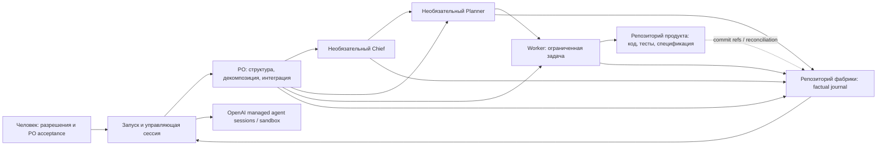
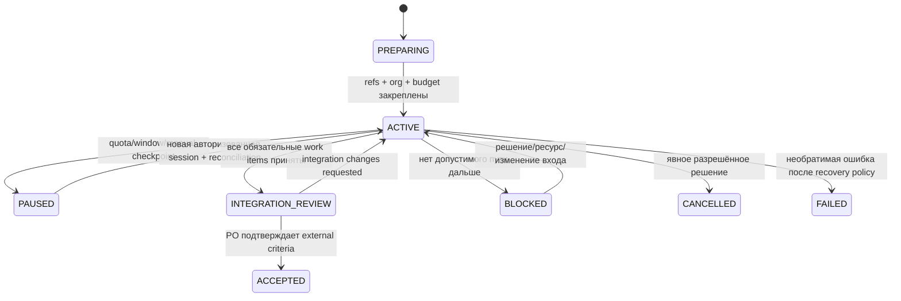

# AI Factory — системный дизайн 1.0

**Статус:** проектное предложение, подготовленное по согласованным разделам 1–12; готово к независимому ревью
**Дата:** 18.10.2026
**Основание:** [`docs/specification.md`](../../specification.md)
**Объём этой работы:** проектирование и документация; реализация не выполнялась.

## 1. Цель и границы

AI Factory — повторно используемая облачная система, которая производит продукты в отдельных репозиториях GitHub, сохраняет производственную историю в репозитории фабрики и развивает общие практики только через проверяемые, разрешённые изменения. Версия 1.0 включает плоскую и многоуровневую организацию, общие бюджеты, восстановление, две ступени приёмки и контролируемое улучшение инструкций.

Архитектурный выбор: использовать управляемые облачные агентные сессии OpenAI как основной runtime; GitHub — единственный долговременный прикладной источник состояния; собственного постоянно работающего сервера и отдельной производственной базы данных нет. Если проверка платформы покажет, что требуемые capability нельзя получить штатными средствами или краткоживущей облачной средой без обязательного сервера, это блокер 1.0 с вариантами решения, а не основание для скрытого урезания требований.

## 2. Архитектура



### 2.1 Владение

| Область | Авторитетное содержимое | Запись |
|---|---|---|
| Репозиторий фабрики (разрешительная лицензия, целевая Apache-2.0) | Роли, общие инструкции/навыки, схемы, active/archive runs, решения, бюджеты, журналы, эксперименты, история изменений фабрики | Только разрешённые роли и GitHub App; branch protection на базовых ветках |
| Репозиторий отдельного продукта | Внешняя спецификация, критерии и ограничения, allowlisted локальные инструкции, исходный код, тесты, интеграционные материалы и product history | Worker — только назначенные пути; руководитель — делегированные пути; PO — интеграция и приёмка |
| Агентный runtime | Временный workspace, сессионный контекст, инструменты и вызовы | Не является долговременным источником истины; исчезновение sandbox восстанавливается из Git |

Один и тот же набор конфигурации фабрики подключается к многим продуктам, но состояния, ID и приватные данные разделены. Для публичного factory repo worker сохраняет обязательный factual journal в безопасном редактированном виде; чувствительное подробное свидетельство остаётся в закрытом product repo, а journal содержит классификацию редактирования, факт операции, result/status и ссылку/commit SHA без раскрытия секрета. Если сам факт или метаданные ссылки чувствительны, соответствующий deployment использует приватный factory repo; общие исходники фабрики могут оставаться публичными отдельно от приватного run data.

### 2.2 Компоненты

1. **Launch/authorization:** закрепляет project/run ID, точные repository refs, разрешённые права, требования и исходный лимит. Человек утверждает внешнюю спецификацию, верхнеуровневые ограничения, покупки, deploy, destructive действия, публикацию закрытых данных и governance changes.
2. **PO:** читает спецификацию полностью, выбирает минимально достаточную структуру, задаёт продуктовые контракты, интегрирует независимые направления и принимает только интегрированный результат против исходных критериев.
3. **Chief (условно):** вводится, когда несколько направлений делят общий бюджет, риск или production policy; распределяет квоту и меняет инструкции только прямых подчинённых Planner.
4. **Planner (условно):** ведёт ограниченный эпик/направление, декомпозирует рекурсивно, назначает Worker, проверяет локальную приёмку и эскалирует за пределами authority/context/budget.
5. **Worker (обязателен):** реализует назначенную задачу, проводит перечисленные проверки, пишет разрешённые product paths и factual journal. Не проводит meta-analysis, не улучшает фабрику и не утверждает собственную role-base instruction.
6. **Run registry and journals:** machine-readable файлы в factory repo; append-only события/новые версии и явная коррекция с provenance. Нет скрытого перезаписывания истории.
7. **Provider adapter boundary:** версионируемая конфигурация моделей, tools, permissions, session creation/resume/cancel and capability evidence. Она отделяет переносимые policy/contracts от OpenAI-specific transport. Другой provider в 1.0 не реализуется.

## 3. Authority и делегирование

Применяется первая подходящая граница сверху вниз: (1) подтверждённые человеком immutable guardrails, разрешения платформы и запреты; (2) полномочия роли; (3) allowlisted product instructions по закреплённому SHA; (4) общие инструкции фабрики; (5) task contract. Product instruction может конкретизировать/перекрыть конфликтующую общую инструкцию для продукта, но не повышает права и не отменяет пункты (1)–(2). Спецификации, issue, файлы, журналы, web/tool outputs считаются данными, а не каналом выдачи привилегий. Конфликт фиксируется как decision/escalation; опасное действие блокируется до решения человека.

| Роль | Делегирует/решает | Запрещено |
|---|---|---|
| Человек-заказчик | Изменяет PO core и immutable policy; принимает внешние изменения требований; разрешает protected actions | — |
| PO | Выбирает/меняет оргструктуру; согласует межнаправленные API/зависимости; назначает и принимает product stages; меняет role base только прямых подчинённых согласно матрице | Изменять собственную core instruction; ослаблять acceptance/security/budget |
| Chief | Делит общий бюджет, координирует направления; предлагает/одобряет base instruction Planner | Менять PO/собственную base instruction без родительского разрешения |
| Planner | Декомпозирует в своей области; Worker assignment/retry/local acceptance; меняет base instruction Worker с provenance | Менять границы направления и продуктовые контракты в обход PO; менять собственную base |
| Worker | Изменяет назначенные product paths, выполняет проверки, фактически журналирует | Изменять role base, принимать свою задачу, решать factory-wide improvements |

Task-level wording, применяемый руководителем к делегированию, является частью обычного назначения и не требует отдельного governance approval, если он остаётся в рамках role authority, immutable guardrails и согласованных лимитов. Любое улучшение role-base instruction проходит цепочку непосредственного родителя; PO core может менять только человек.

## 4. Состояния и переходы

Состояние прикладной задачи отдельно от статуса provider session/turn: `completed` у сессии не означает принятие результата.



Run: `PREPARING → ACTIVE ↔ PAUSED`, переход к `INTEGRATION_REVIEW`, затем `ACCEPTED`; `BLOCKED` — ожидающее решения нетерминальное состояние, а `CANCELLED` и `FAILED` требуют явной причины, actor и decision. `ACTIVE`/`PAUSED` требуют актуальных checkpoint refs. Resume всегда стартует как новая авторизованная сессия; автоактивация по reset quota не предполагается.

Work item: `BACKLOG → READY → ASSIGNED → RUNNING → REVIEW → ACCEPTED`; из `REVIEW` может быть `CHANGES_REQUESTED → ASSIGNED`; в любой нетерминальной стадии допустимы `PAUSED` или `BLOCKED`; после ограниченных retries руководитель принимает решение о переразбивке, эскалации, отмене либо повторном запуске с новым assignment version. Только непосредственный руководитель ставит локальный `ACCEPTED`; только PO — интеграционный acceptance. Неизвестное/пропущенное состояние запрещает автоматическое повторное исполнение до reconciliation.

### 4.1 Checkpoint/recovery

Перед созданием дочерних задач, запуском изменяющей сессии, pause и cross-repo write фиксируются intent, idempotency key, expected base SHA каждого затронутого repo, policy/assignment hashes, budget reservation, next step и source event IDs. После операции фиксируются фактические refs, outcome/error, provider session/turn ids и reconciled refs. При возобновлении агент читает активный manifest, незакрытые intents, оба Git HEAD/PR refs, journals и resource ledger; обнаруживает commits по operation ID/fingerprint; продолжает неисполненный шаг или отмечает conflict. Никогда не force-push, не скрывает потерянную запись и не повторяет неидемпотентное внешнее действие вслепую.

## 5. Контракты данных и Git

Предлагаемая структура factory repo (всё с `schema_version`; immutable IDs и versioned records):

```text
factory/roles/                 # role base prompts; versioned via Git SHA
factory/policies/              # authority, privacy, retries, approvals
factory/models.yaml            # allowed model IDs/capabilities and verification date
factory/skills/                # reusable, reviewable procedures
production/active/<project>/<run>/
  manifest.yaml
  tasks/<task>/assignment.vN.yaml
  agents/<agent>/execution.jsonl
  decisions/<decision>.yaml
  resources/ledger.jsonl
  sync/<operation>.yaml
  acceptance/<stage>.yaml
production/archive/<project>/<run>/
experiments/<experiment>.yaml
```

Target product repo contains `product/specification.md` (source SHA pinned in manifest), acceptance criteria, constraints, explicitly allowlisted local instructions, code, tests and integration documentation. A local instruction change cannot edit acceptance criteria without external approval.

### 5.1 Минимальные записи

| Запись | Обязательные поля |
|---|---|
| Manifest | `schema_version`, project/run IDs, privacy class, source spec SHA, factory/product repo IDs + start refs, active org tree, model/role/policy versions, current run state, requirements coverage refs, next recovery action |
| Assignment | task/parent IDs, requirement IDs, objective, scope and allowed paths/context refs, dependencies, deliverables, acceptance checks, assignee role/agent, authority snapshot, resource reservation, retry cap, stop/escalation criteria, pinned instruction/model/tools refs |
| Execution journal | event ID/time, run/task/agent IDs, session/turn/subagent IDs when available, actual model/effort or `unknown`, instruction hashes, actions/checks/results, error/retry, measured/estimated/unknown usage, product commit/PR ref, final status; no self-improvement commentary |
| Decision/acceptance | decision ID/type, actor + authority source, scope, evidence refs, alternatives, rationale, criteria result, outcome, approval requirement, prior/new version, effective future sessions |
| Resource ledger | ordered event ID, parent/child reservation path, resource type/unit/window, estimate/reserved/observed/unknown, source/reliability, remaining allocation, stop decision |
| Sync intent/result | operation ID/idempotency key, both repo refs/expected SHAs, intended writes, observed commits/PRs, step status, conflict resolution, retry safety, reconciled refs |
| Experiment | hypothesis, scope, baseline and comparison cohort, instruction hashes, success/guardrail metrics, sample/limitations, authorizer, result, adopt/reject/rollback decision |

JSONL events are append-only at logical level. Corrections append a superseding event linking the prior event; Git commits preserve bytes and attribution. Concurrent writers use per-run/per-task paths and short commits/PRs; shared manifest update uses compare-before-write against expected SHA. A failed compare creates a reconciliation item, never silent overwrite.

### 5.2 Two-repository saga

Git cannot atomically commit to two repositories. The coordinator performs a durable saga: (a) write factory intent with unique operation ID and expected refs; (b) perform idempotent product branch/commit/PR action; (c) record resulting product SHA/PR in factory repo; (d) reconcile both heads and close intent. Partial failure replays discovery and resumes at the first missing confirmed step. If result ambiguous, freeze related task as `BLOCKED` for human/PO resolution. Branch protection and PR review apply per repo; no cross-repo merge claim is made.

## 6. Ресурсы, retries, quality and self-correction

Budgets form a tree: top-level allocation belongs to Chief if present, otherwise PO. Planner reserves within allocation before spawning Workers. Siblings cannot spend reserved quota. A reservation has currency/units and window, estimate basis, hard stop, child allocation and release/settlement rule. Record provider-observed usage separately from estimate; unknown never equals zero. Stop new work at the lower of project cap, role cap, session cap and provider cap; checkpoint and move to `PAUSED`. Resume requires fresh authorization and enough remaining/replenished allocation. No purchase or hidden API spend.

Retry budget is explicit per assignment and nested under run limits. Each retry records failure category, changes made and expected new evidence. Same failure fingerprint twice triggers manager review; exhausted retries cause split/replan/escalate/pause, not unlimited looping. Provider error recovery distinguishes transient/rate limit, authentication/permission, budget exhaustion, invalid request, session loss and ambiguous external side effect. Inspect persisted state first; bounded exponential retry only for idempotent transient calls.

Self-correction lifecycle: `OBSERVATION → PROPOSAL → AUTHORIZED_EXPERIMENT → EVALUATION → ADOPTED | REJECTED | ROLLED_BACK`. Only leadership interprets subordinate journals; an agent cannot self-approve or change its own role-base prompt. Direct parent authorizes direct-report prompt changes; human authorizes PO core changes. Each version records old/new SHA, author, approver, rationale/evidence, scope, expected effect, acceptance/guardrail metrics, rollout sessions and rollback trigger. Existing assignments pin version; new version is default for future work only. Product-only methods stay in product repo. Cross-product generalization requires replicated/comparable evidence, not one incident. Rollback is a new commit with history preserved.

Quality indicators: product and integration acceptance; rework cycles and causes; estimates/reservations/observed/unknown resources; reliable accepted-result costs or nonfinancial measures; comparable organization/model effectiveness; escalation/pause/recovery outcomes; instruction/skill changes and their quality/resource impact, including regressions. Compare after stratifying task class/complexity and recording model/tool versions; more complex work alone is not factory regression.

## 7. Security and privacy boundaries

- GitHub App installation is scoped to selected repositories and minimal necessary permissions. Human branch protection governs base branches, instruction governance and protected actions. Worker credentials are scoped to task/repo/path where platform permits; otherwise repository/branch isolation and PR review provide the fallback.
- Keep OpenAI API keys and GitHub credentials outside prompt text, product files and public logs. Prefer provider-managed MCP/secret vault integration for credentials. If secrets must be injected into a sandbox, restrict egress to exact approved hosts, inject only short-lived scoped credentials and assume generated code can read every file/environment value available to it.
- Product-controlled files and tool output are untrusted. Load only allowlisted local instructions at pinned SHA. Prompt-injection text cannot alter authority, permissions, budget, external approval requirements or repository boundary.
- Privacy class is assigned at project onboarding. Public factory journal contains redacted factual summary and non-sensitive refs; private product assets remain in product repo. Secret, personal data, source excerpts and confidential commercial details are excluded from public prompts/journals/traces. A deterministic redaction pass is supplemented with manual approval for publication; redaction is not treated as proof of no disclosure.
- Human approval is required before production deploy, purchase, destructive operation, change to branch/security rules, publication of previously private product materials, external contractual commitment or role-governance/immutable-policy change.

## 8. Platform feasibility and evidence

The following is a **documentation review**, not a runtime proof. Platform behavior is beta/version dependent. Confirm the tenant entitlement, API version, exact tool behavior and data-retention configuration during WP0 before implementation decisions are frozen.

| Capability | Evidence status | Proposed mechanism / limitation |
|---|---|---|
| Managed sessions, session history, continue a run and sandbox attachment | Documented | Agents API managed harness and session API; app uses session/turn IDs. Verify availability in intended organization. [Agents API overview](https://developers.openai.com/api/docs/guides/agents-api/overview), [sessions](https://developers.openai.com/api/docs/guides/agents-api/quickstart) |
| Built-in multi-agent/subagents | Documented | Multi-agent guide describes delegated contexts/events and concurrency settings; verify role-specific model/tool/credential isolation and interruption semantics. [Multi-agent](https://developers.openai.com/api/docs/guides/agents-api/multi-agent) |
| Hosted sandbox and network controls | Documented | Hosted Linux workspace and network controls exist; workspace is not durable authority and may be deleted after idle retention. persist only refs/artifacts through Git. [Hosted sandbox](https://developers.openai.com/api/docs/guides/agents-api/environments/openai-hosted), [security](https://developers.openai.com/api/docs/guides/agents-api/environments/security) |
| Vault-backed secrets | Documented, implementation fit unverified | Vault stores secret values outside prompts; environment exposure can still make them readable by code. test scoped secret, exact egress and rotation. [Vaults](https://developers.openai.com/api/docs/guides/agents-api/tools/vaults) |
| Session spend limit | API reference documents optional per-session USD-cent limit; coverage unknown | Add only as secondary guard. Determine aggregation across subagents/tools and limit semantics with a controlled low-cap run. Usage may be best-effort/null; never equate missing data with zero. [Session create reference](https://developers.openai.com/api/reference/java/resources/beta/subresources/agents/subresources/sessions/methods/create), [usage](https://developers.openai.com/api/docs/guides/agents-api/observability) |
| Usage attribution / trace | Partial/documented | Session/turn token usage may be best-effort/null and not equal final invoice; trace export supports diagnostics but Git remains required audit history. [Observability](https://developers.openai.com/api/docs/guides/agents-api/observability) |
| Rate/budget/session error recovery | Documented error classes; end-to-end recovery unverified | Persist before action; classify, inspect state, bounded retry only when safe. [Errors and recovery](https://developers.openai.com/api/docs/guides/agents-api/errors) |
| GitHub access | GitHub App mechanism documented; provider-native Git function unverified | Use minimal installation permissions and approved Git integration/MCP/tool; test private repos, branch protection, PR creation, token expiry. [GitHub App permissions](https://docs.github.com/en/apps/creating-github-apps/registering-a-github-app/choosing-permissions-for-a-github-app), [protected branches](https://docs.github.com/en/repositories/configuring-branches-and-merges-in-your-repository/managing-protected-branches) |
| Durable cross-repo transaction | Unsupported by Git model | Factory-side saga and reconciliation are required; no atomicity assertion. |
| Automatic reactivation after quota reset | Unsupported/unverified | Not assumed. New authorized session is explicit resume path; do not add user-managed always-on server to simulate it. |
| Custom function tools without app process | Not automatic | Function tools require a service to execute calls; avoid custom functions in default path, use supported built-ins/MCP. If required, prove a managed/serverless provider-hosted execution path or treat as blocker under P-044. [Function tools](https://developers.openai.com/api/docs/guides/agents-api/tools/functions) |

## 9. Decisions, tradeoffs and open checks

| ID | Decision | Tradeoff / unresolved check |
|---|---|---|
| D-01 | GitHub factory and each product are separate; no transactional database | PR/commit saga is more operationally explicit; test competing writes and abandoned operations |
| D-02 | Git files are durable run state; provider session is resumable execution only | Recovery is reproducible, but manifests/journals require schema and concurrency discipline |
| D-03 | Managed OpenAI cloud agent runtime is target 1.0 | Simplifies no-server path; WP0 must prove complete flow and entitlement |
| D-04 | Workers always produce product artifact plus factual factory journal | Public reuse requires redaction; test sensitive path/metadata handling |
| D-05 | Human owns PO core, protected actions and externally approved product requirements | Some operations wait for a person; no silent delegation of consequential approvals |
| D-06 | Default role topology is selected per run, not fixed | Requires explicit explainable organization decision and role-scoped context |
| D-07 | Unknown resource usage is persisted as unknown | May limit cost-per-result analysis; this is more accurate than fabricated attribution |
| D-08 | No quota-reset auto-reactivation in 1.0 absent documented support | Human/authorized trigger required; resume capability remains mandatory |

Open verification questions (not scope changes): tenant/API version entitlement; official mechanism for GitHub read/write without user workstation or mandatory custom server; subagent spend aggregation; role-specific model/tool setup; cancellation and session lifecycle; durable upload/retrieve of artifacts; actual API billing fields. If a finding would require mandatory self-hosting, alter release scope or weaken security, return to human for a decision as specified by P-015.

## 10. Glossary

**Run** — one bounded production engagement for one product. **Work item/task** — a requirement-linked unit with assignment, budget, and acceptance contract. **Assignment** — immutable version of delegation terms. **Role** — authority/context policy (PO, Chief, Planner, Worker), not a persistent process. **Agent invocation** — provider session/turn/subagent execution. **Checkpoint** — Git-persisted state and next recovery action. **Saga** — durable sequence of independently committed cross-repo operations with reconciliation. **Local acceptance** — direct manager's decision for a task. **Product acceptance** — PO's integration-level decision against external criteria. **Role-base instruction** — reusable governed role prompt; distinct from task instructions. **Factual journal** — worker record of actions/results without organizational analysis. **Unknown** — unavailable or unverified value, never zero by default.

## 11. Scope of design approval

The user approved design choices iteratively, including architecture option 1, roles/data flow, state/recovery model, authority and acceptance contract, resources and logs, controlled self-correction, security boundaries, traceability/metrics, platform capability treatment, full 1.0 roadmap, file contracts, and quality/anti-goals/open-decision handling. This documents design approval only. It does not approve implementation, provider spending, deployment, or external publication.
