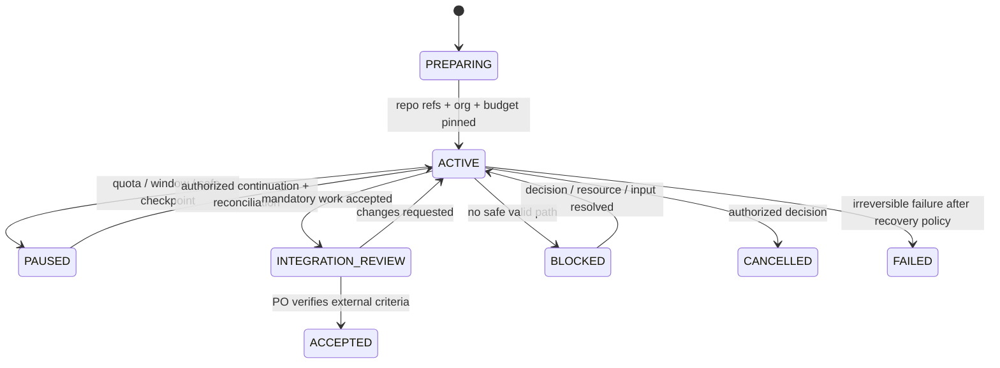

# State, events and recovery

## State model

Application run state is independent of Codex task/turn/thread status. A provider says `completed` does not mean the product work item is accepted (P-022, P-036).

`BLOCKED` is recoverable and nonterminal. `CANCELLED` and `FAILED` require a reason, actor, authority and decision record. `ACTIVE` and `PAUSED` require an up-to-date checkpoint. Illegal state transitions fail closed. Unknown or inconsistent state requires reconciliation before any automatic replay.

Work item states are `BACKLOG → READY → ASSIGNED → RUNNING → REVIEW → ACCEPTED`, with `REVIEW → CHANGES_REQUESTED → ASSIGNED`, and `PAUSED`/`BLOCKED` reachable from any nonterminal stage. Retrying work is a bounded attempt with recorded failure fingerprint and changes; creating a new attempt does not erase the old one. Only the direct parent accepts a work item; PO accepts integrated product output.

## Durable files and event semantics

The factory repository is the durable registry for run state. Each record is JSON; append-only journals and resource ledgers are JSONL. Git commit history supplies attribution and recovery. See [data contracts](../interfaces/data-contracts.md) for fields and paths.

- Immutable IDs identify projects, runs, tasks, role/agent instances, events and cross-repo operations. A correction creates a superseding event that points to the prior record; it does not rewrite the event.
- `manifest.json` is the current snapshot for discovery and state; journal events are the ordered evidence. On recovery, validate that the snapshot agrees with event history and referenced Git SHAs; disagreement is `BLOCKED` until reconciled.
- Run/task state changes, organization changes, assignments, parent acceptance, escalation, resource reservation/observation, instruction decisions, checkpoints, sync operations and protected actions are recorded.
- Each agent execution record captures role/agent, assignment, source/policy/model hashes, Cloud task/thread/turn identifiers when visible, actual model/effort or unknown, actions/checks, artifact refs, errors/retries, usage class and final status. Worker records stay factual.
- Parallel writers use distinct task/agent event paths; shared manifest updates use expected-SHA compare-before-write. Merge conflicts are explicit reconciliation items.

## Checkpoint protocol

Checkpoint before an expected quota/window boundary, pause, task completion/exit, assignment spawn that changes active run state, or a product/factory side effect. It contains at minimum:

1. `run_id`, current state and checkpoint event ID;
2. current factory and product repository IDs, branches and observed HEAD/PR refs;
3. latest committed manifest/event/journal refs and their expected SHAs;
4. org tree, assignment IDs/versions, child thread status/IDs when visible;
5. accepted, active, blocked and not-yet-started work with dependency edges;
6. open cross-repo intents and idempotency keys;
7. resource reservations, latest observed/estimated/unknown evidence and policy threshold;
8. pinned requirement, role, policy, skill and model/catalog references;
9. explicit `next_action`, safe retry/reconciliation instruction and escalation recipient.

The checkpoint records observed values only. It does not store raw credentials, private product source, or a claim that the Cloud process itself is restorable.

## Resume and recovery algorithm

1. Reopen the same Cloud task if its saved state is available and authorized; otherwise an operator starts a new recovery Cloud task under the same `run_id`. No child assignment is transferred as a separate task.
2. Load the committed factory manifest, relevant JSONL journals, open saga intents and product/factory refs. Verify schema versions, privacy class, P/A requirement pin, expected/current SHAs, instruction versions, state transition chain and ID/reference integrity.
3. Inspect both repositories read-only. For each open operation, search for the operation ID or fingerprint before deciding whether to replay; do not repeat an ambiguous external action.
4. Rebuild accepted work, open assignments, current child status where visible, budgets, retries, decisions and explicit next action. Provider-only state that cannot be reloaded is marked unknown.
5. Compare the reconstructed state against the checkpoint. Any missing/contradictory evidence, changed base SHA or unresolved external outcome moves the affected work to `BLOCKED`; write a reconciliation event only after an authorized decision.
6. Before resuming, confirm current usage/headroom according to the [resource policy](resource-management-and-self-correction.md), verify connected repository permissions and obtain required continuation authorization.
7. Resume the same run at the earliest safe next action. Never redo accepted artifacts unless a new assignment explicitly reopens them.

The documented saved-VM recovery period is bounded and can change; the intended account's current retention is checked in WP0. Git is authoritative beyond that period.

## Failure classes and response

| Failure | State/response |
|---|---|
| Transient, idempotent local/Git read failure | Retry within the explicit retry cap; record attempt and outcome. |
| Rate limit / quota or session window exhausted | Finish safe checkpoint, mark `PAUSED`, stop fan-out; human checks availability before resume. |
| Authentication, permission or repo-access loss | Stop writes, record non-sensitive error/evidence, escalate to operator; do not change provider route. |
| Expected SHA changed | Do not overwrite; record conflict and reconcile/rebase only after authorized review. |
| Partial cross-repository result | Follow [saga reconciliation](../interfaces/cross-repository-saga.md); discover side effect before retry. |
| Ambiguous non-idempotent action | Mark `BLOCKED`, request PO/human decision, do not replay blindly. |
| Saved VM lost or stale | Start an operator-authorized recovery task from Git under same run ID; no dependency on the old workspace. |
| Snapshot/journal mismatch or invalid schema | Block automated continuation; preserve evidence and repair by appended/committed correction with authority. |

## Recovery acceptance

Recovery is correct only when the reconstructed run agrees with committed records, accepted work is not repeated, unresolved work has an explicit next action, repository refs are current or blocked, and every unknown runtime fact remains marked unknown. A successful task restart alone is not evidence of correct recovery. A-06, A-13 and A-14 define end-to-end evidence.

