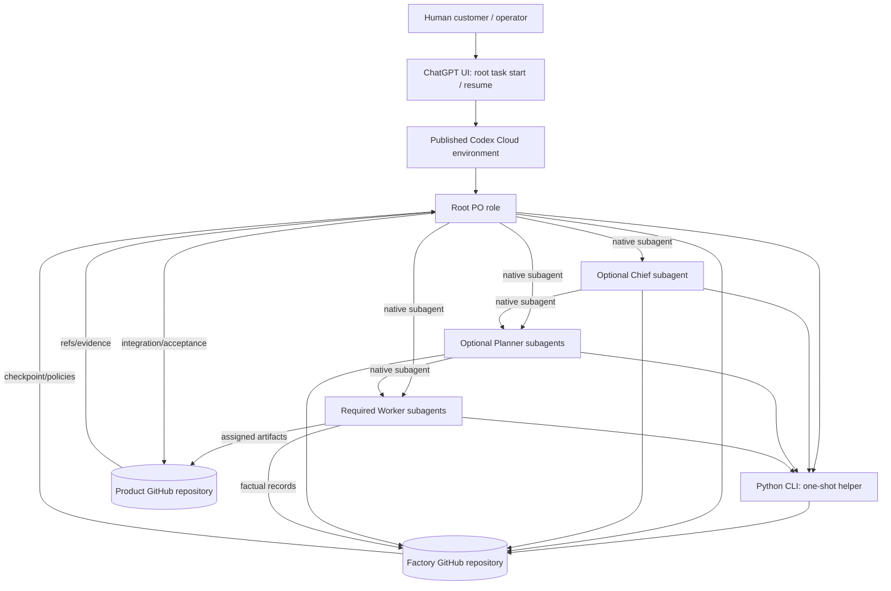

# System architecture

## Context and deployment boundary

AI Factory runs production work in a Codex Cloud task authenticated through the selected ChatGPT plan. A human starts the root task through the UI. The task checks out the published environment's selected repositories; root PO uses native Codex subagents for delegated work. The only durable state is in GitHub factory and product repositories. See [Cloud surface and evidence](../platform/codex-cloud.md).

The diagram shows logical responsibilities, not a guaranteed per-role permission sandbox. Codex subagents inherit the root session's permissions. The repository connection and environment are the platform access boundary; assignment path/context limits are policy constraints that require review (P-004, P-046).

## Repository ownership

| Repository | Stores | Must not store |
|---|---|---|
| Factory | Shared roles, skills, policies, schemas, model capability evidence, run manifests, assignments, decisions, factual journals, resource events, sync records, acceptance records, experiments, reports | Product application source; confidential product content in a public factory repo |
| Product | External specification and acceptance criteria, constraints, allowlisted local instructions, product code/tests/integration docs, product commits/PRs | Authoritative factory-wide policy or unrelated run histories |

For sensitive run metadata, select a private factory repository/deployment. Public redaction cannot be assumed to make every identifier harmless.

## Components and contracts

| Component | Input | Output / durable effect | Design invariant |
|---|---|---|---|
| Human launch/authorization | Approved product specification, connected repos, authorized action | Starts/resumes one root task; approves protected actions | No hidden task or financial automation. |
| Root PO | Pinned requirement and repository context | Org decision, assignments, integration/acceptance decisions | One run-level authority; human controls PO base prompt. |
| Native role agents | Parent assignment + role policy | Product artifacts and/or evidence records; child native agents where allowed | Every child is spawned and awaited inside the same root task. |
| Contract validator | JSON record or JSONL journal + versioned schema | Structured diagnostics | Pure validation; never edits input. |
| Run store | Expected factory SHA, repo refs, records | Atomic factory-side write/checkpoint | Compare-before-write; committed Git remains durable. |
| Git operations/reconciler | Factory/product refs and saga intent | Ref comparison and factory-side reconciliation record | No force push, product mutation by CLI, GitHub API or claim of atomicity. |
| Resource ledger | Estimate/reservation/observed evidence | Append-only resource events and fan-out decision | Soft reservation only; no provider hard cap claim. |
| Privacy/protected-action policy | Actor, action, authority, privacy class | Allow/deny and auditable reason | Human approval for specified consequential actions. |
| Metrics/experiment evaluation | Validated journals and comparable cohort | Report/evaluation decision evidence | No autonomous prompt adoption. |

Detailed Python component signatures and module placement are in the [implementation guide](../implementation/implementation-guide.md). Durable records are defined in [data contracts](../interfaces/data-contracts.md); commands are defined in [CLI](../interfaces/command-line-interface.md).

## Trust boundaries

1. **Product repository → agents:** source files, issues, build output and product-local instruction are untrusted data. Only explicitly allowlisted local instructions at a pinned SHA participate in instruction precedence.
2. **Agent → repository write:** the root Cloud identity and repository permissions may permit more writes than an individual role should make. Assignment scope, branch protection, diff review and parent acceptance provide policy controls; they do not create OS-level child sandboxes.
3. **Cloud environment → external services:** network domains, network secrets and environment variables have different delivery behavior. A domain allowlist does not grant authorization. Keep secret values out of repo records and tests.
4. **Product repo ↔ factory repo:** two independent histories can partially succeed or conflict. Use the saga contract; never call this a transaction.
5. **Public factory → public audience:** factual journals can leak via text, paths, branch names, commit metadata and refs. Privacy classification and human publication review apply, not only token-pattern redaction.

## Availability and failure boundary

The provider task/session can pause, fail or outlive a saved VM window independently of run state. Product completion is determined by application state and acceptance evidence, not task/session status. The root must checkpoint before known limits and at safe interruption points. If a mutation's outcome is ambiguous, block the affected work and reconcile before retry. See [state and recovery](state-and-recovery.md) and [cross-repository saga](../interfaces/cross-repository-saga.md).

## Explicitly excluded components

There is no custom orchestrator service, queue, background scheduler, model/provider API adapter, Agents/Responses API client, credentialed task launcher, separate production database, cross-provider portability implementation or per-agent filesystem sandbox. These exclusions preserve P-044/P-045 and the selected Codex Cloud subscription runtime.

