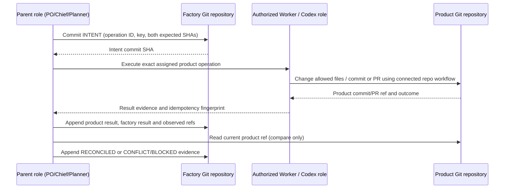

# Factory/product repository saga

## Purpose

GitHub cannot atomically commit a factory repository and a separate product repository. The saga makes intent, each side effect and reconciliation durable and replay-safe (P-006). It coordinates actions taken by the authorized Codex role and Git operations; the Python CLI does not independently mutate the product repository, open a PR or call GitHub API.

## Preconditions

Before a product write, the parent must have:

- a validated assignment and authority for the product paths/action;
- current full commit SHAs for both factory and product repos;
- a unique operation ID and idempotency key;
- target branch/PR policy from the product repository; no implicit branch-protection override;
- a factory-side intent committed against expected factory SHA;
- a safe retry/reconciliation policy and privacy classification.

If any precondition is missing, do not start the product write.

## Protocol

Stages:

1. **Intent:** write `INTENT_RECORDED` in factory repo before product mutation. Include operation ID/key, assignment, scope, both expected SHAs, intended effect, authorization and source events.
2. **Product effect:** authorized role performs the bounded product change through connected Git/Codex workflow, respecting branch/PR policy. It must make the change idempotent where possible and attach operation ID/fingerprint to a commit/record in a privacy-safe way. If product effect does not begin, record that fact.
3. **Factory result:** record product commit/PR refs, actual product SHA, actor, outcome, checks and error class. This step itself uses expected factory SHA and append-only correction semantics.
4. **Reconciliation:** independently inspect both heads/PR state. Close `RECONCILED` only when the product effect and factory result agree with the intent; otherwise record `CONFLICT` or `BLOCKED` and an authorized next action.

## Idempotency and recovery

On replay, first search the product branch/commit/PR and factory records for the idempotency key and operation fingerprint. If the expected product effect is already present, record the discovered result rather than apply it again. If the product result exists but factory result is absent, append the missing result with its original source evidence. If factory intent exists and no product effect is found, verify the current base SHA and authority before retrying. If the outcome cannot be proven, set `BLOCKED`; do not guess.

Idempotency keys are unique per intended effect. Reusing one key with different assignment, scope or payload is a contract error. A correction/superseding result references prior event without removing it.

## Concurrency and conflicts

- The expected factory SHA guards writes to shared run state; the expected product SHA guards the assigned product base.
- A stale SHA stops the operation. Re-read refs and the diff, record a conflict, and ask the owning parent to replan/rebase or escalate. Do not overwrite or force-push.
- Parallel work should use separate paths/branches/records where possible. Shared manifest updates are serialized through compare-before-write.
- Branch/PR merge is independently governed in each repository. Saga completion is not a cross-repo atomic merge or assertion that both default branches changed simultaneously.
- Product commit/PR action availability and dual-repository persistence in Codex Cloud must pass WP0. A documented multi-repo selector does not prove the intended account can write both repos.

## Status model

| Status | Meaning | Allowed next action |
|---|---|---|
| `INTENT_RECORDED` | Durable intent exists; product step may or may not have started | Inspect product ref before retry. |
| `PRODUCT_APPLIED` | Product change/commit/PR identified; factory result not complete | Record the exact result using factory compare-before-write. |
| `FACTORY_RECORDED` | Both sides reported; final refs not reconciled | Read both refs and validate. |
| `RECONCILED` | Intent, product result, factory result and refs agree | Close operation; no replay. |
| `CONFLICT` | Expected ref changed or independent update conflicts | Parent-authorized replan/rebase/resolve. |
| `BLOCKED` | Outcome ambiguous or no safe authorized resolution | PO/human decision; no automatic retry. |

## What this protocol does not provide

No distributed lock, atomic transaction, rollback of a published external side effect, GitHub API call, task scheduler or guarantee against unrelated use of the same account. Recovery is based on durable refs and evidence, not an assumption that the Cloud VM survived. CLI behavior is specified in the [command-line contract](command-line-interface.md).

