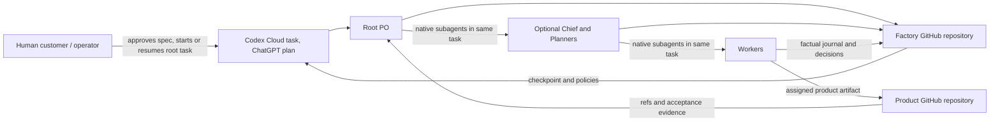

# AI Factory v1.0 technical overview

## Purpose

AI Factory is a reusable production system that takes an externally approved product specification, organizes Codex agents to build that product, records operational evidence, and improves shared production practices only through authorized, evaluated changes. v1.0 includes both product delivery and governed factory improvement. A flat run is valid for simple work; the system must also support dynamically selected native hierarchical delegation for complex work.

This is a technical contract for implementation. The product's externally visible obligations remain in [`../specification.md`](../specification.md); the design rationale is summarized in [`decisions.md`](decisions.md).

## System context

The human selects and authorizes the production context. The root PO owns the run and composes the organization. Chief, Planner and Worker are roles implemented by native Codex subagents as needed. The factory repository contains shared policy and durable production history; the separate product repository contains product-specific requirements and artifacts. The published Cloud environment supplies task setup and access; its VM and agent threads are not durable state.

## Invariants

1. Factory code/policy and product code/criteria are kept in separate repositories (P-001–P-003).
2. Every run has a PO function and at least one Worker; optional leadership is justified per run (P-013–P-016).
3. Every delegated unit has an immutable, requirement-linked assignment; its parent owns local acceptance (P-019–P-024).
4. Provider session completion never means product acceptance. The PO separately accepts integrated output against externally approved criteria.
5. Git records are the recovery source. Multi-repository changes are sagas, not atomic transactions (P-005, P-006, P-030, P-035, P-036).
6. Codex Cloud subscription usage is the selected runtime. The product creates no OpenAI API runtime, server, database, or automatic task launcher. The operator starts/resumes the root task through the ChatGPT UI in the selected v1.0 workflow.
7. Within a run, child work uses native subagents under the same root Cloud task. If WP0 cannot prove the required organization, concurrency or model behavior, v1.0 is blocked for a human decision; no API or separate-task child relay is allowed.
8. Usage is classified as observed, estimated, reserved or unknown. Unknown is not zero; reservations are not represented as provider-enforced limits.
9. Product and factory improvements require correct ownership and authority. Active assignments pin their instruction versions; adoption is not presumed to be improvement.
10. Public factory records are factual and privacy-reviewed; sensitive detail remains in the appropriate private product/factory repository.

## Major components and ownership

| Component | Owns | Does not own |
|---|---|---|
| Root PO | Run intake, immutable requirement pin, organization decision, integration dependencies, acceptance and escalation | Human-owned changes to PO core instructions or external approval decisions |
| Chief (optional) | Cross-direction plans and shared budget allocation; manages Planners | Product-wide acceptance or human-protected actions |
| Planner (optional) | Directional decomposition, Worker assignments, child budget, local review | Cross-direction product contracts or its own base-prompt approval |
| Worker (required) | Assigned product artifact, relevant checks, factual execution journal | Factory meta-analysis, self-acceptance or role-base changes |
| Python package/CLI | Contract validation, deterministic local record operations, Git ref checks, reports | Model/agent API calls, dispatch, scheduling, workflow choices, Cloud tasks |
| Factory repository | Reusable instructions, policies, skills, schemas, run/decision/resource/experiment records | Product source code or unredacted confidential product material in public mode |
| Product repository | External specification, product criteria, allowlisted local instructions, product source/tests/integration | General factory governance |
| Codex Cloud environment | Reusable dependencies, tools, repo connections and approved task access | Durable run state or proof of unsupported per-agent isolation |

Detailed contracts: [agent operating model](architecture/agent-operating-model.md), [state and recovery](architecture/state-and-recovery.md), [data contracts](interfaces/data-contracts.md), [CLI](interfaces/command-line-interface.md), [Cloud platform](platform/codex-cloud.md).

## One production run at a glance

1. A human approves the source specification and uses a published Cloud environment. The operator launches the root task and supplies project/run context.
2. PO pins source specification SHA, factory revision, product/factory repository refs, privacy class, role/policy/model references and initial plan in the factory repository.
3. PO chooses the smallest justified org tree. It records requirements, work dependencies, acceptance criteria, resource estimates/reservations and stop rules before it asks Codex to spawn a child.
4. The parent reviews its direct child result, records acceptance or a bounded change request, and escalates beyond its authority. Workers commit only allowed product changes and write factual factory evidence.
5. PO integrates, verifies external criteria and records the final product acceptance decision. The provider task's status is kept separate.
6. Before pause, critical cross-repository action or session end, the root saves a checkpoint with refs, open intents, child status and explicit next action.
7. Leadership may classify evidence as product-specific or factory-wide. Factory instruction changes require authority, experiment, comparable metrics and rollback criteria; human alone changes PO core/immutable policy.

## Not in v1.0

Additional model providers, API billing, a factory-owned server/database/queue, automatic task creation/resumption, automatic quota-reset reactivation, guaranteed per-agent sandbox isolation, guaranteed hard per-run plan quotas, autonomous protected actions, model fine-tuning as the factory learning mechanism, GitHub Actions as mandatory journal storage, Superpowers as a runtime dependency, a fixed number of agents, and unverified Cloud capability are excluded. See [decisions](decisions.md) and [Codex Cloud](platform/codex-cloud.md).

## Glossary

| Term | Meaning |
|---|---|
| Product | Independently versioned software in its own GitHub repository. |
| Factory | Reusable role/policy/tooling repository plus its run and experiment records; it does not contain product source. |
| Run | One authorized production engagement for one product, with a stable `run_id`, requirements, org tree, resource policy and recovery path. |
| Work item / task | A requirement-linked unit of work represented by an immutable assignment version. |
| Assignment | Parent-authored contract for a child: objective, scope, evidence, acceptance, resources, retry and stop/escalation rules. |
| Role | Authority/context policy (PO, Chief, Planner, Worker), not a persistent service or necessarily a separate process. |
| Cloud task | Provider-hosted execution workspace started/resumed through the ChatGPT UI in the approved v1.0 flow. |
| Native subagent thread | Child agent spawned by Codex from within the root task; ordinary child delegation stays in that same task. |
| Checkpoint | Committed state snapshot plus open work/operations and an explicit safe next action. |
| Local acceptance | Direct manager's decision against a child assignment's pinned criteria. |
| Product acceptance | PO's integration-level decision against external product criteria. |
| Saga | Durable sequence of separate repository operations with idempotency and reconciliation; it is not an atomic transaction. |
| Factual journal | Evidence of what an agent actually did/checked/observed, without Worker self-improvement analysis. |
| Unknown | Unavailable/unverified value, never numeric zero by default. |

